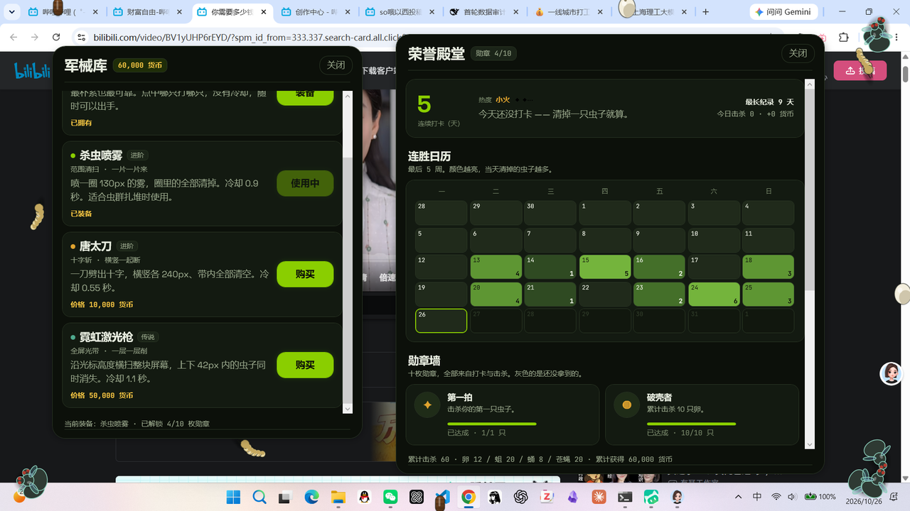

# 🪰 蛆虫任务 · Maggot Task

> **拖延的终点是苍蝇。**
>
> 其他待办应用哄你：打卡、积分、小星星。
> 这个应用不哄你——它把你的每个任务变成一只**活着的虫子**，
> 放在你屏幕上，当着你的面腐烂。

[](#-下载)
[](#-测试)
[](#-隐私)
[](#-许可证)

---

## ⚡ 只想直接体验？不用编译

**[📦 点这里打开安装包文件夹](以上为源代码，想直接体验请查看这个文件夹/)** —— 里面只有能直接装、直接跑的文件。

| 平台 | 文件 | 前置条件 |
|:--|:--|:--|
| Windows 10/11 x64 | [`MaggotTask-Windows-1.3.0.zip`](以上为源代码，想直接体验请查看这个文件夹/MaggotTask-Windows-1.3.0.zip)（0.8 MB） | 需装 [.NET 7 桌面运行时](https://dotnet.microsoft.com/zh-cn/download/dotnet/7.0) |
| Android 8.0+ | [`MaggotTask-Android-1.2.10.apk`](以上为源代码，想直接体验请查看这个文件夹/MaggotTask-Android-1.2.10.apk)（7.0 MB） | 允许「未知来源」+ 悬浮窗权限 |

> 详细系统要求、逐步安装说明、以及**两个版本的功能差异**（元游戏目前仅 Windows 有）
> 都写在那份 [文件夹里的 README](以上为源代码，想直接体验请查看这个文件夹/README.md) 中。
>
> 源代码仍在 `android/` 与 `windows/`，本文件夹只是分发出口，不影响构建。

---

## 🥚 这是怎么运作的

你在应用里写下一个任务，按下「产卵」——

```
🥚 卵 ——孵——> 🐛 蛆 ——僵——> 🛖 蛹 ——破——> 🪰 苍蝇
        90 分钟基准腐烂（0.25× ~ 8× 可调）
```

- **管了它**（点一下「我去做了」）→ 虫子回血，继续当蛆；
- **做完了**（点「拍死它」）→ 啪。任务光荣牺牲，进战果榜；
- **不管它** → 它会烂透、破壳、变成一只苍蝇，**永远趴在你的桌面上羞辱你**；
- **继续不管** → 桌上的苍蝇开始**无限繁殖**。每只新苍蝇都是你拖延的直接后果，
  带着可追溯的血脉世代（「记英语单语 · 第 7 代」）。

没有关闭按钮，没有"稍后提醒"，没有激励弹窗。
你的桌面会变成 procrastination 的罪证陈列馆。

**重点**：它不锁你手机、不拦截任何操作。虫子只是在那儿爬——
但你每次解锁屏幕都会看见它们，而它们在腐烂。这就够了。

---

## ✨ 特性

| | |
|:--|:--|
| 🖥️ **全屏悬浮层** | 虫子爬在**真正的桌面上**——穿透点击，不挡任何操作（Android 悬浮窗 / Windows 置顶点击穿透窗） |
| 🧬 **失控繁殖** | 烂透的任务孵化苍蝇；两只苍蝇随机交配产下新一代——拖延会指数增长 |
| 📅 **每日 / 每周任务** | 「锻炼」「写周报」到点自动产卵；漏掉的那周不会消失，它会**连本带利地烂** |
| 🖱️ **悬停审讯** | 鼠标/长按停在虫子上，弹出气泡：这是哪个任务、烂到多少、你冷落了它多久 |
| 🎯 **亲手击毙** | 关掉穿透，光标换成苍蝇拍；0.18 秒浮出名牌，点一下就是一声脆响 + 一次洁净消除（没有血、没有汁） |
| 💰 **击杀经济** | 卵 100 / 蛆 50 / 蛹 25 / 苍蝇 10 —— 越早清越值钱。金币只来自亲手击杀 |
| 🔫 **军械库** | 杀虫喷雾 1,000 / 唐太刀 10,000 / 霓虹激光枪 50,000，一键清一片，冷却换强度 |
| 🏅 **十枚勋章** | 从「第一拍」到「千虫之主」，全部由真实击杀与连胜派生，绝不虚标 |
| 🔥 **连胜日历** | 多邻国式连胜 + 5 周热力日历：今天清一只就算打卡，断了会心疼 |
| 🔊 **一套音效** | 产卵、孵化、化蝇、交配、拍死——每种人生阶段都有声音反馈（可关） |
| 🩺 **体检卡** | 「虫群在不在、视口多大、时钟走没走」一张卡说清——从不让你对着黑屏猜 |
| 💥 **崩溃自白书** | 万一闪退，下次启动直接把完整堆栈拍你脸上，长按复制即可报修 |
| ♿ **减少动效适配** | 系统开「减少动态效果」→ 虫子静止但绝不消失（这曾是个 bug，现在写进了测试） |



<sub>左：军械库 —— 三件进阶工具，价格与命中范围明码标价。右：荣誉殿堂 —— 当前连胜、5 周热力日历、十枚勋章。</sub>

## 📱 下载

### Android（8.0+）

从 [**安装包文件夹**](以上为源代码，想直接体验请查看这个文件夹/) 下载
`MaggotTask-Android-1.2.10.apk` 直接安装：

1. 允许安装未知来源应用；
2. 首次打开按引导授予**悬浮窗权限**（SYSTEM_ALERT_WINDOW）；
3. 点「让虫群上桌」。第一颗卵已经躺在你的桌面上了。

> 适用于 vivo / OPPO / 小米等激进后台策略的 ROM：应用自带降级与诊断，
> 悬浮层上不了桌时自动退回应用内显示，并在体检卡写明原因。

### Windows（10/11）

从 [**安装包文件夹**](以上为源代码，想直接体验请查看这个文件夹/) 下载
`MaggotTask-Windows-1.3.0.zip`，**完整解压**后双击 `MaggotTask.exe`：

1. 先装 [.NET 7 桌面运行时](https://dotnet.microsoft.com/zh-cn/download/dotnet/7.0)
   （或 `winget install Microsoft.DotNet.DesktopRuntime.7`）；
2. 解压 zip 到任意文件夹（不要在压缩包里直接双击）；
3. 托盘出现虫子图标即启动成功。

> 没有代码签名，首次运行 SmartScreen 会拦一下：「更多信息」→「仍要运行」。
> 也可以按下面的方式从源码构建。

## 🛠️ 从源码构建

**Android**（JDK 17 · Android SDK 34 · Gradle 8.7）：

```bash
cd android
./gradlew assembleRelease        # 产物: app/build/outputs/apk/release/
./gradlew testDebugUnitTest      # 53 项单元测试（引擎 43 + 摆放回归 10）
```

**Windows**（.NET 7 SDK · WPF）：

```bash
cd windows
dotnet build MaggotTask.sln -c Release
./MaggotTask/bin/Release/net7.0-windows/MaggotTask.exe --selftest   # 594 项断言
```

元游戏的数值契约（奖励 / 价格 / 连胜 / 勋章条件）见
[`docs/meta-game.md`](docs/meta-game.md) —— 改数值先改那份文档。

## 🧠 为什么两端长得一模一样

因为**先有规格，后有代码**：[`docs/lifecycle-spec.md`](docs/lifecycle-spec.md)
（15 节，含验收标准）是唯一事实来源。Android 的 `LifecycleEngine.kt` 和
Windows 的 `LifecycleEngine.cs` 各自独立实现同一份规格——腐烂数学、阶段机、
繁殖、离线补偿、每日/每周生成，全部对齐。改机制先改规格，两端跟着跑。

```
docs/lifecycle-spec.md   ←── 唯一事实来源（契约）
        │
   ┌────┴─────┐
android/    windows/
Kotlin      C# / WPF
Compose     悬浮穿透窗
```

数据结构（`state.json` v4）两端共享，换设备不换虫。

## 🔒 隐私

- Android 清单里**根本没有申请 INTERNET 权限**——虫子想上传你的耻辱都没有门路；
- 所有数据只存在本地（Android 私有目录 / Windows `%APPDATA%\MaggotTask`）；
- 没有账号、没有云同步、没有统计埋点。你的拖延只属于你。

## ⚠️ 已知限制

- 国产 ROM 的省电策略可能杀后台服务（应用会降级到应用内显示并在体检卡注明，
  建议把电池策略设为「无限制」）；
- 部分机型会把 `MATCH_PARENT` 悬浮窗测量成 0×0——已用显式像素尺寸规避；
- Windows 端需 .NET 7 桌面运行时。

完整排障手册与内部开发笔记见 [`docs/DEVELOPMENT.md`](docs/DEVELOPMENT.md)。

## 📜 灵感

致每一个下载过十七个番茄钟、最后全都躺在文件夹里吃灰的人。
这次不一样——**这次它们会烂**。

## 📄 许可证

MIT。拿去用，拿去改，拿去治你的拖延——
但请别移除拍死音效，那是整个应用唯一温柔的暴力。

---

<div align="center">

**今天不管，明天桌面多一只。**

🥚 → 🐛 → 🛖 → 🪰 → 🪰🪰 → 🪰🪰🪰🪰……

</div>
